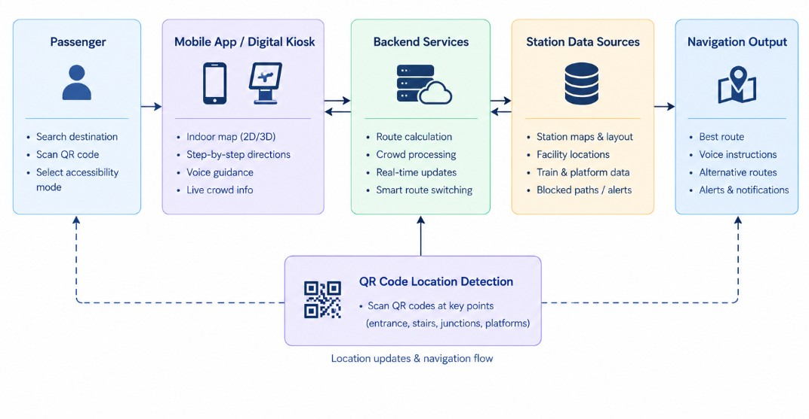
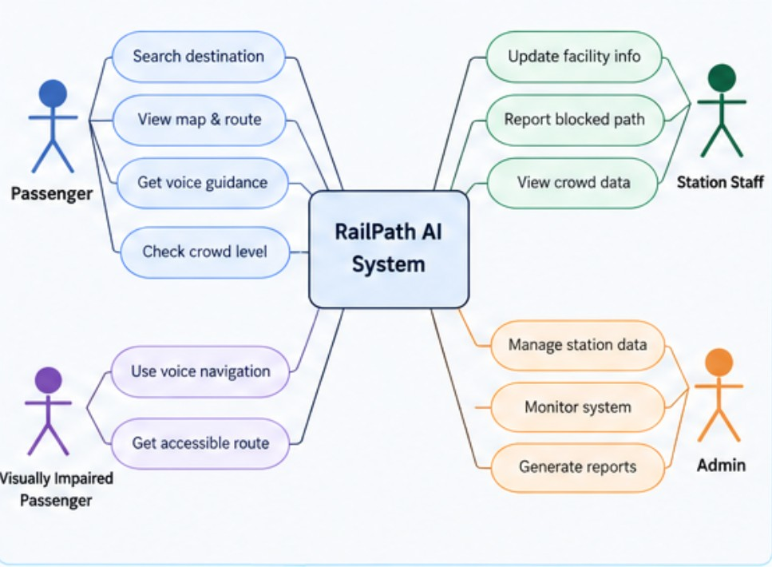

# Smart India Hackathon Workshop
# Date:27-10-2026
## Register Number:
## Name: Dharini.S
## Problem Title
SIH 1710: Enhancing Navigation for Railway Station Facilities and Locations
## Problem Description
Background: Railway stations are complex environments with numerous facilities and locations such as ticket counters, platforms, restrooms, food courts, and waiting areas. Passengers often face difficulties in navigating these spaces, especially in large or unfamiliar stations. Efficient and user-friendly navigation systems are crucial for improving passenger experience, reducing congestion, and ensuring timely travel connections. Description: The problem involves developing a comprehensive navigation solution for railway stations that assists passengers in locating various facilities and destinations within the station premises. This includes creating detailed maps, providing real-time directions, and integrating features such as accessibility options for individuals with disabilities. The solution should be intuitive, easy to use, and accessible via multiple platforms, including mobile devices and digital kiosks. Key challenges include updating navigation information in real-time, ensuring accuracy, and accommodating the diverse needs of all passengers. Expected Solution: The expected solution is a multi-platform navigation system that provides detailed, real-time directions to all facilities and locations within a railway station. This system should include: A mobile application with 3D interactive maps and step-by-step navigation. Digital kiosks located throughout the station with touch-screen interfaces. Voice-guided navigation for visually impaired passengers. Regular updates to reflect changes in station layout and facility locations. Integration with existing railway apps and services for seamless user experience. The solution should enhance the overall passenger experience by reducing confusion, saving time, and improving accessibility within the station.

## Problem Creater's Organization
Ministry of Railway

## Idea

The RailPath AI is a sophisticated indoor navigation tool that assists in providing safe, fast, and autonomous navigation to the passengers in large and unfamiliar railway stations. In comparison to common map apps, it offers not only the indoor route navigation but also crowd-level data, accessibility-aware paths, and landmark-based navigation as well.

The passenger can choose their destination from platforms, ticket counters, restrooms, lifts, food courts, waiting rooms, etc. Step-by-step instructions are provided through the mobile app or digital kiosk. The system may propose less busy corridors to follow, give preference to lifts and ramps for mobility-challenged travelers, and even voice instructions for the visually impaired passengers.

The innovation offered by the system is the Smart Route Switching: if the corridor becomes overcrowded, if the way is blocked, or the platform is moved, the system suggests another route based on the most recent data of the station. Another innovative feature is the usage of QR codes put in entrance zones, stairways, and important corridors to identify the current position of the traveler without special positioning systems throughout the station.

## Proposed Solution / Architecture Diagram

The RailPath AI system is composed of the following five modules:

1. **Interactive Indoor Map:** An interactive station map that indicates platforms, exits, ticket counters, restrooms, lifts, stairs, and other facilities.
2. **Smart Routing Algorithm:** Determines the optimal route taking into consideration distance, accessibility options, closures, and crowds.
3. **Accessibility Option:** Supplies users with lift/ramp-friendly routes along with voice navigation and directions with the use of landmarks.
4. **Location Detection with QR Codes:** Users scan QR codes located at special points in the station to identify their location and further navigate the station.
5. **Station Management Dashboard:** Station staff can update the location of facilities, report closed routes, and share information about crowds.

## Use Cases

## Technology Stack

### 1. Frontend (Client-Side)
- HTML5, CSS3, JavaScript
- React.js for the user-friendly interface
- Leaflet.js for the interactive maps of indoor stations
- Progressive Web App (PWA) for mobile device support
- Web Speech API for voice-based guidance
- QR scanning for determining the indoor location

### 2. Backend (Server-Side)
- Python and Flask for backend development
- REST API for connecting the front and backends
- Flask-SocketIO for real-time updates
- NetworkX for finding the shortest route through Dijkstra's algorithm

### 3. Database
- SQLite database for saving station maps, facilities, routes, and QR location
- PostgreSQL database for future scalability

### 4. Navigation and Accessibility
- QR codes to detect passengers' location
- Graph-based pathfinding to find the best way
- Alternative route suggestions based on crowd situation
- Voice guidance for blind passengers
- Accessible routes with lifts and ramps
- Offline caching of maps with important navigation data

### 5. Dashboard and Visualization
- Chart.js to show crowd and facility status visualization
- React.js for the station management dashboard
- Flask for the update of facility information and blocked routes

### 6. Development Tools
- Visual Studio Code
- Git and GitHub
- Python virtual environment
- Browsers for testing
- Postman for API testing

## Dependencies

### Backend Dependencies
- `flask` - Web Application Framework
- `flask-cors` - Frontend-backend communication
- `flask-socketio` - Real-time update capability
- `networkx` - Shortest-path route computation
- `qrcode` - QR code creation
- `sqlalchemy` - Database interaction
- `eventlet` - Optional async server

### Frontend Dependencies
- `react` - Interface design and construction
- `react-dom` - React App rendering
- `leaflet` - Interactive station maps
- `react-leaflet` - Leaflet with React
- `socket.io-client` - Real-time communication
- `html5-qrcode` - QR Code Scanning
- `chart.js` - Dashboards and charting

### System Requirements
- **OS**: Windows, Linux, or Mac
- **CPU**: Dual-Core CPU or better
- **RAM**: At least 4 GB; 8 GB is recommended
- **Space**: At least 2 GB available
- **Browser**: Latest version of Chrome, Firefox, or Edge
- **Internet**: Internet connection required initially and for future online updates; can be used offline with cached maps