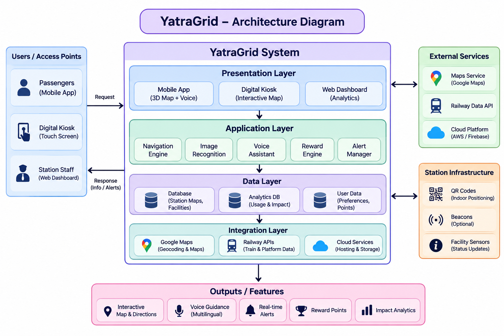
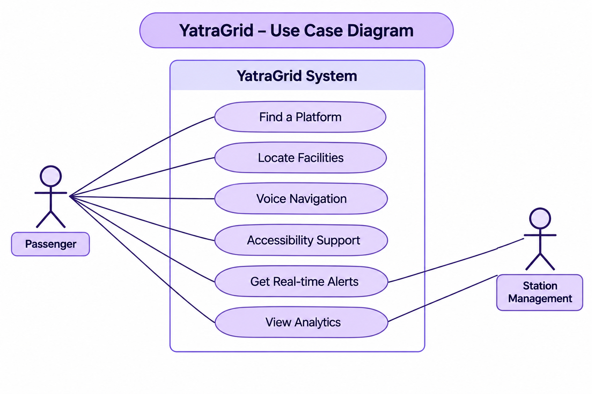

# Smart India Hackathon Workshop
# Date:27-10-2026
## Register Number:
## Name: Dharini.S
## Problem Title
SIH 1710: Enhancing Navigation for Railway Station Facilities and Locations
## Problem Description
Background: Railway stations are complex environments with numerous facilities and locations such as ticket counters, platforms, restrooms, food courts, and waiting areas. Passengers often face difficulties in navigating these spaces, especially in large or unfamiliar stations. Efficient and user-friendly navigation systems are crucial for improving passenger experience, reducing congestion, and ensuring timely travel connections. Description: The problem involves developing a comprehensive navigation solution for railway stations that assists passengers in locating various facilities and destinations within the station premises. This includes creating detailed maps, providing real-time directions, and integrating features such as accessibility options for individuals with disabilities. The solution should be intuitive, easy to use, and accessible via multiple platforms, including mobile devices and digital kiosks. Key challenges include updating navigation information in real-time, ensuring accuracy, and accommodating the diverse needs of all passengers. Expected Solution: The expected solution is a multi-platform navigation system that provides detailed, real-time directions to all facilities and locations within a railway station. This system should include: A mobile application with 3D interactive maps and step-by-step navigation. Digital kiosks located throughout the station with touch-screen interfaces. Voice-guided navigation for visually impaired passengers. Regular updates to reflect changes in station layout and facility locations. Integration with existing railway apps and services for seamless user experience. The solution should enhance the overall passenger experience by reducing confusion, saving time, and improving accessibility within the station.

## Problem Creater's Organization
Ministry of Railway

## Idea

YatraGrid is a smart indoor navigation system that helps passengers locate platforms, ticket counters, restrooms, food courts, waiting halls, lifts, and exits inside railway stations.

Its unique feature is Transfer-Time Intelligence, which considers the passenger's destination, walking route, accessibility needs, and available train-transfer time to recommend a suitable path.
- QR-based indoor positioning: Identify a starting point by scanning station QR codes.
- Smart route planning: Calculate suitable routes to platforms and facilities.
- Accessibility navigation: Prioritize step-free routes, ramps, and accessible lifts.
- Multilingual voice assistant: Provide spoken directions in supported languages.
- Live station alerts: Reflect verified platform changes, facility closures, and crowd updates.
- Digital kiosk support: Help passengers who do not have smartphones.
- Offline maps: Allow passengers to access downloaded station maps without continuous internet.

## Proposed Solution / Architecture Diagram

## Use Cases

## Technology Stack

Frontend -	React.js
Backend -	Node.js and Express.js
Database -	PostgreSQL
Mapping -	Google Maps Platform for supported outdoor mapping; indoor station maps and custom routing
Authentication -	Firebase Authentication
Voice assistance -	Text-to-speech API
Development tools -	Git, Postman or Insomnia
Deployment -	AWS or another cloud provider

## Dependencies

Dependency	Estimated time  - 10 days
Station map and facility data collection - 10 days
Mapping and route implementation - 10 days
Backend and database -	7 days
Voice and accessibility features -	5 days
Testing and integration - 5 days

Estimated prototype budget: ₹50,000.